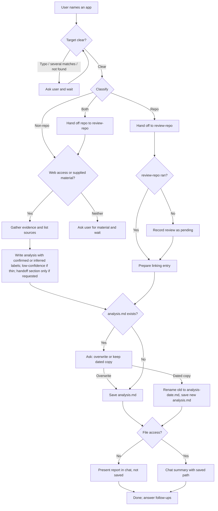

# Review: analyze-app

**Reviewed with:** Claude Code, Opus 5.5, unknown thinking level

## Summary

`analyze-app` turns an application name or URL into a saved, evidence-labeled report on what the app is, what it does, and how it works, so the user and later agents have a stable reference (for example, before planning reverse-engineering work). It is used whenever the user wants to understand an app they cannot or should not run, and it defers repositories to `review-repo`.

## Scores

Rubric:

- **5** Excellent — ready to use; no meaningful issues.
- **4** Good — minor issues that do not affect outcomes.
- **3** Adequate — works, but issues cause occasional inconsistency or waste.
- **2** Weak — significant gaps; results are often unreliable.
- **1** Poor — unclear or unusable without major revision.

| Area | Score | Justification |
|------|-------|---------------|
| Scope | 4 | Focused on one app per run with explicit exclusions ("Do not plan or perform reverse-engineering or rebuild work…"). The split with `review-repo` is clear for explicit repo URLs, but repos discovered during research are not routed (see improvements). |
| Human readability | 5 | Five short, numbered steps, a sectioned output spec, and a one-paragraph boundary. A reader can tell what it does from the headings alone. |
| Agent executability | 4 | Directives are imperative and the stop points ("Do nothing else until the user answers") are explicit. A few branches leave the agent guessing: repos found mid-research, local non-repo paths, and a repo-only rerun over an existing full analysis. |
| **Overall** | **4** | Ready to use for typical requests. The gaps sit in less common routing paths. |

## Scope analysis

**Verdict: appropriate.**

The skill does one job (a passive, conceptual app analysis) and pushes adjacent work elsewhere: repositories and security vetting to `review-repo`, and detailed APIs, data models, and rebuild plans out of scope, with the optional handoff section as the bridge to a planning agent. Triggers in the description ("analyze, research, or explain an application") are distinct from `review-repo`'s ("review, vet, audit, or explain a repository"), though "explain" appears in both; the description's closing clause ("repository targets are handed to review-repo") resolves that overlap. There is no overlap with the other skills in the repository.

## Areas for improvement

### High priority

1. **Workflow › 2. Classify and route — repos discovered during research are unhandled.** Classification happens before step 3, but for a plain name like "Excalidraw" the agent often learns the app is open source only while gathering evidence. Nothing says whether to hand off mid-research, finish first, or ignore the repo, so the "Both" path depends on what the user typed rather than on the app. **Fix:** add to step 3: "If research reveals a public source repository, treat the target as Both: hand the repository to `review-repo` before saving, and continue the non-repo analysis."

### Medium priority

2. **Workflow › 2 and Operating boundary — local paths that are not repositories.** "Repo: … local repository path" covers repositories, but a local install folder, binary, or exported data has no route, and the boundary does not say whether reading local app files is allowed. **Fix:** state whether a local non-repo path counts as supplied material (readable, never executed) or is out of scope.
3. **Workflow › 5. Save the report — repo-only rerun over a full analysis.** If `analysis.md` holds a full analysis and the user now supplies the repo URL, the overwrite question could replace a full report with a link-only entry. **Fix:** for a repo-only target with an existing full analysis, add the repository review link to Related reports instead of asking to overwrite.
4. **evals/scenarios.md — uncovered branches.** No scenario covers several possible matches, `review-repo` being unavailable (pending review), conflicting sources, AI-directed text in a source, or a multi-app request. **Fix:** add scenarios for at least the pending-review and AI-directed-text paths, which have specific observable outcomes.

### Low priority

5. **Workflow › 5 — dated-copy date source.** "Using its own analysis date" assumes the old report records one. **Fix:** fall back to the file's last-modified date when no analysis date is found.
6. **Workflow › 5 — folder name collisions.** Two distinct apps that share a name would map to the same kebab-case folder after disambiguation. **Fix:** add a qualifier (for example, the domain) to the folder name when the user had to choose between candidates.
7. **Constraints and edge cases — repeated rule.** "Request for a security review of a repository: route it to `review-repo` as in step 2" restates step 2 and the boundary. **Fix:** drop the line or merge it into the run/install bullet to save tokens.

## Token cost

*Estimates, at about 4 characters per token.*

| Stage | Size | Estimated tokens |
|-------|------|------------------|
| Frontmatter (always loaded) | ~380 characters | ~95 |
| `SKILL.md` body (loaded on invocation) | ~6,000 characters | ~1,500 |

**Runtime cost (qualitative):** dominated by research, not instructions. A typical run reads several web pages or documents and writes one file. A Repo or Both target also loads and runs `review-repo` (about 2,000 more instruction tokens plus its repository reading), which can several-fold the cost of a run.

## Estimated runtime

*Estimates.*

- **Turns:** 1 for a clear target; 2–3 when a typo, ambiguity, or existing-report question needs an answer.
- **Agent processing:** about 2–6 minutes for a non-repo analysis; about 5–15 minutes when `review-repo` runs as well, depending on repository size.
- **User wait time:** near zero beyond processing for clear targets; each clarification adds however long the user takes to answer.

## Reliability

**Rating: good.**

- The main paths (clear target, typo, repo URL, existing report, thin evidence) are specified with explicit stop points and file outcomes.
- Confirmed or inferred labeling and the low-confidence label guard against presenting guesses as facts.
- Gaps: repos discovered mid-research (high), local non-repo paths, and repo-only reruns (medium) may produce inconsistent routing or lose a prior report's content.
- **Evals:** present, 8 scenarios with Pass and Fail criteria covering the normal, boundary, and main edge paths. Several secondary branches are untested (item 4).
- **Confidence in this review:** moderate-high. The skill is short and fully read, but it has not been run, so the runtime and research-quality estimates are untested.

## Workflow diagram

