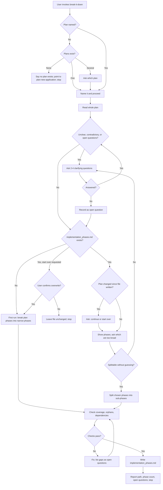

# Review: break-it-down

**Reviewed with:** Claude Code, Sonnet 5.5, reasoning level unknown

## Summary

`break-it-down` turns a plan's broad build phases into narrow, self-contained phases that other agents can pick up, and saves them to `implementation_phases.md` without touching `plan.md`. Use it after `plan-new-application`, and run it again whenever a phase still looks too big.

## Scores

| Dimension | Score | Justification |
|-----------|-------|---------------|
| Scope | 5 | One clear job with explicit exclusions ("Do not write code… dispatch or launch agents, or create a new plan"). |
| Human readability | 5 | Numbered workflow, short sections, and a fixed output order make it easy to scan. |
| Agent executability | 4 | Directive and complete, but "small enough to complete and verify on its own" is subjective and a few paths are unspecified (see improvements). |
| **Overall** | **4** | Ready to use. Remaining issues are minor and affect consistency, not outcomes. |

Rubric: 5 excellent, 4 good, 3 adequate, 2 weak, 1 poor.

## Scope analysis

**Appropriate.** Responsibility is a single transformation (plan phases to narrower phases) in a single output file. Triggers are precise ("break down, narrow, or further split the phases of a plan.md"). Both modes (first run, re-run) share the same phase format and checks, so keeping them together avoids duplication.

Overlap: it sits next to `plan-new-application`, whose `plan.md` it consumes. The boundary is clean, since the plan skill produces a high-level outline and states that a later agent does the splitting. No merge is suggested.

## Areas for improvement

### High

None.

### Medium

1. **Phase granularity is subjective.** Section "4. First run" says each phase must be "small enough to complete and verify on its own," with no sizing guidance. Two runs could produce very different depths. *Fix:* add a concrete test, for example "one agent can finish it in a single working session and the Done when check is observable without other unfinished phases."
2. **Eval coverage misses several specified paths.** `evals/scenarios.md` has no scenario for: the plan having changed since the file was written (step 5.1), a plan with no build phases (edge case), an early stop, prompt-like text inside the plan, or a host that cannot write files. *Fix:* add scenarios for the plan-changed check and the no-build-phases confirmation; the others can be lower priority.

### Low

3. **"Split everything" is unspecified.** Section "5. Re-run" assumes the user names particular phases. If they say "split all of them," behavior is undefined. *Fix:* state that it applies the split to every phase, still after confirming.
4. **Single-plan auto-proceed.** Section "1. Locate the plan" proceeds when exactly one plan exists, while the user may have meant another plan stored elsewhere. Low risk because the plan is named first. *Fix:* optional; no change needed.
5. **Unsplittable phases on a first run.** Step 5 handles a phase that is already minimal on a re-run, but step 4 does not say what to do when a plan phase is already narrow. *Fix:* add "keep it as one phase and carry it over unchanged."

## Token cost

All figures are estimates at about 4 characters per token.

- **Frontmatter (always loaded):** about 430 characters, roughly 110 tokens.
- **`SKILL.md` body (loaded on invocation):** about 6,900 characters, roughly 1,730 tokens.
- `evals/scenarios.md` (about 5,300 characters, roughly 1,330 tokens) is for maintainers and is not loaded at runtime.
- **Runtime note:** the dominant variable cost is reading the plan and, on re-runs, the existing `implementation_phases.md`. No other files are read.

## Estimated runtime

Estimates only.

- **First run, clear plan:** 1–2 turns. Agent processing about 1–3 minutes; user wait about the same.
- **First run, unclear plan:** 2–4 turns, since clarifying rounds come first. Agent processing 2–5 minutes in total; user time depends on answering the questions.
- **Re-run:** 2–3 turns (show phases, user picks, write). Agent processing about 1–3 minutes.

## Reliability

**Rating: good, with moderate-to-high confidence.** Evals exist (7 scenarios) and cover the main paths: first run, re-run, unclear plan, plan-edit request, missing or ambiguous plan, dispatch request, and overwrite confirmation. Boundary adherence is well tested. Gaps are the less common paths listed under improvement 2. No conflicting rules were found. Risks are mainly output variability from the subjective granularity rule.

## Workflow diagram

