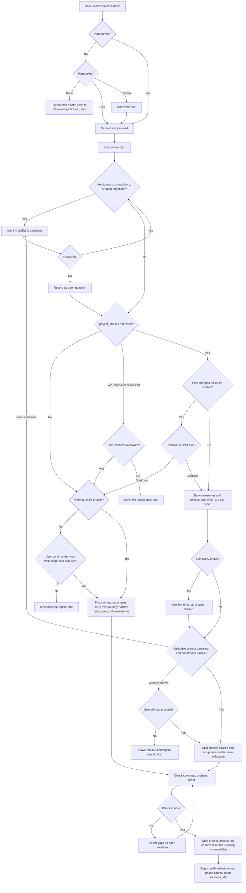

# Review: break-it-down

**Reviewed with:** Claude Code, Opus 5.5, reasoning level unknown

## Summary

`break-it-down` turns a plan's broad build phases into clear, ordered phases grouped under milestones and saves them to `project_phases.md` beside the plan, without touching `plan.md`. Use it after `plan-new-application` when you want a trackable route to the end goal, and run it again when a phase still looks too big.

## Scores

| Dimension | Score | Justification |
|-----------|-------|---------------|
| Scope | 5 | One transformation into one file, with explicit exclusions ("dispatch or launch agents, divide work into tasks for parallel agents, or create a new plan"). |
| Human readability | 5 | Numbered workflow, separate field lists for phases and milestones, and a fixed output order. |
| Agent executability | 4 | The sizing test and checks are concrete. Milestone boundaries and milestone changes on a re-run are left to judgment (see improvements). |
| **Overall** | **4** | Ready to use. The remaining issues affect consistency on some paths, not the core outcome. |

Rubric:

- **5** Excellent: ready to use; no meaningful issues.
- **4** Good: minor issues that do not affect outcomes.
- **3** Adequate: works, but issues cause occasional inconsistency or waste.
- **2** Weak: significant gaps; results are often unreliable.
- **1** Poor: unclear or unusable without major revision.

## Scope analysis

**Appropriate.** The skill does one job: it reads one plan and writes one file. Its triggers are specific ("break down, organize, or further split the phases of a plan.md into phases and milestones"). First runs and re-runs share the same fields and checks, so it makes sense to keep them together.

**Handoff mismatch:** `plan-new-application` still says a later agent will "break into subagent-ready tasks" and that "the later reviewing agent does that." This skill now refuses to divide work for parallel agents, so the two skills describe the handoff differently. No merge is suggested; the wording in `plan-new-application` needs to be aligned.

## Areas for improvement

### High

None.

### Medium

1. **Milestone boundaries are subjective.** "4. First run" defines a milestone as "a meaningful, demonstrable state" but gives no test for where one ends or how many a plan should have. Two runs could group the same phases very differently. *Fix:* add a short test, for example "end a milestone where a user or stakeholder could see or try the result, and prefer milestones that each contain more than one phase unless the plan is small."
2. **Re-runs cannot change milestones.** "5. Re-run" splits phases only and says to "leave all other phases and milestones unchanged." The skill doesn't say what to do when the user asks to split, merge, or regroup milestones, or to move a phase between them. *Fix:* either allow milestone regrouping on a re-run with the same checks and a revision log entry, or tell the user it requires starting over.
3. **The clarification threshold is broad.** "2. Read and assess the plan" asks questions whenever the plan is "silent on something a phase needs." Almost any plan leaves out some implementation detail, so the skill may question users even on clear plans. *Fix:* limit questions to gaps that change which phases or milestones exist, or their order, and leave smaller details for the phase's Inputs or open questions.
4. **Old output files aren't handled.** The output is now `project_phases.md`. A folder that holds only an `implementation_phases.md` from an earlier version will be treated as a first run, with no mention of the older file. *Fix:* add an edge case: if `implementation_phases.md` exists, mention it and ask whether to use it as the starting point or ignore it.

### Low

5. **Numbering can clash with milestone order.** "4. First run" keeps plan-phase numbers as parent prefixes but also requires each milestone's phases to be "consecutive." If a milestone needs phases from two plan phases out of order, the two rules pull against each other. *Fix:* say that milestone order takes priority and prefixes are only for traceability.
6. **Some paths have no evals.** `evals/scenarios.md` doesn't cover "split every phase," carrying over an already-narrow plan phase, a host that cannot write files, embedded instructions in the plan, or an early stop. *Fix:* add scenarios for the first two; the others are lower priority.

## Token cost

All figures are estimates at about 4 characters per token.

- **Frontmatter (always loaded):** about 470 characters, roughly 120 tokens.
- **`SKILL.md` body (loaded on invocation):** about 8,000 characters, roughly 2,000 tokens.
- `evals/scenarios.md` (about 7,600 characters, roughly 1,900 tokens) is for maintainers and isn't loaded at runtime.
- **Runtime note:** most of the variable cost comes from reading the plan and, on re-runs, the existing `project_phases.md`. No other files are read.

## Estimated runtime

Estimates only.

- **First run, clear plan:** 1–2 turns. About 1–3 minutes of agent processing, and roughly the same user wait.
- **First run, unclear plan:** 2–4 turns, because clarifying rounds come first. About 2–5 minutes of agent processing in total. User time depends on how long the answers take.
- **Re-run:** 2–3 turns (show phases, user picks, write). About 1–3 minutes of agent processing.

## Reliability

**Rating: good, with moderate-to-high confidence.** Ten eval scenarios exist. They cover the first run, re-run, an unclear plan, a plan-edit request, a missing or ambiguous plan, dispatch and parallel-agent requests, overwrite confirmation, a changed plan, and a plan with no build phases. Boundary adherence is well tested. The instructions don't contradict each other. The tension between phase numbering and milestone order (item 5) is minor. The main risks are inconsistent milestone grouping and over-questioning (items 1 and 3), plus the paths without evals listed in item 6.

## Workflow diagram

