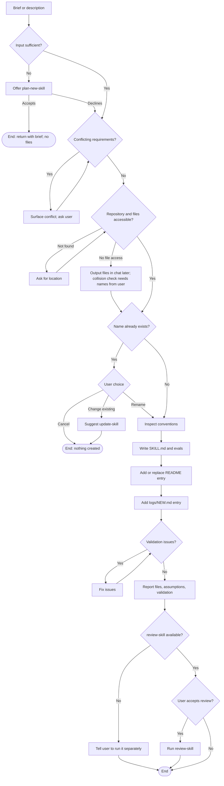

# Review: create-skill

**Reviewed with:** Claude (Claude Code), Opus 5.5, reasoning level unknown

## Summary

`create-skill` turns a confirmed brief from `plan-new-skill`, or a direct description, into a finished skill directory. It writes `SKILL.md` and `evals/scenarios.md`, adds a README entry, logs the creation in `logs/NEW.md`, and offers a review. It is the authoring step of the repository's plan → create → review → update pipeline. Use it whenever someone wants a new skill built rather than designed or changed.

## Scores

| Area | Score | Justification |
|------|-------|---------------|
| Scope | 5 | Authoring only. Planning goes to `plan-new-skill`, changes to existing skills go to `update-skill`, and "Never overwrite an existing skill" is explicit. |
| Human readability | 4 | The numbered workflow (1–8) and the mandated structure in step 4 are easy to follow. The fallback for hosts without file access is packed into one long bullet. |
| Agent executability | 4 | Steps are imperative and completion is defined. A few branches are underspecified: what "fix" means when the validation finds an overlap, and how the no-access fallback interacts with step 2. |
| **Overall** | **4** | Ready to use. The remaining issues are edge-case gaps and missing eval coverage for the new fallback paths, not structural flaws. |

**Rubric**

- **5** Excellent — ready to use; no meaningful issues.
- **4** Good — minor issues that do not affect outcomes.
- **3** Adequate — works, but issues cause occasional inconsistency or waste.
- **2** Weak — significant gaps; results are often unreliable.
- **1** Poor — unclear or unusable without major revision.

## Scope analysis

**Verdict: appropriate.** The skill has one responsibility: authoring a new skill from supplied requirements. The description's closing clause ("not plan one or change an existing one") and the operating boundary separate it cleanly from `plan-new-skill` and `update-skill`. Offering `review-skill` is a handoff, not overlap, because it only runs with consent.

## Areas for improvement

### High priority

None.

### Medium priority

1. **Step 7, Composable: "fix them" can conflict with "Do not add requirements."** If the validation finds that the new skill overlaps an existing one, step 7 says to fix the issue before reporting completion. Fixing an overlap usually means changing scope, which the last bullet of Constraints and edge cases forbids without the user's input.
   *Fix:* "If validation finds a scope overlap with an existing skill, report it to the user and ask how to proceed instead of changing scope; fix other issues directly."
2. **Constraints and edge cases: the no-file-access fallback is ambiguous.** It says to "ask the user for the repository location," but in a host with no file access a location doesn't help. The same bullet then covers file output and the name-collision check, so the order of these actions is unclear.
   *Fix:* Split it into separate bullets. **Repository not found:** ask for its location. **No file access:** ask for the list of existing skill names for step 2 (skip the check and say so if the user can't provide them), then present every file's content in chat with its intended path.
3. **evals/scenarios.md: the new fallback paths and one accept path are untested.** No scenario covers a host without file access, a host where `review-skill` can't be run (step 8), or the user accepting the `plan-new-skill` offer in step 1. Scenario 3 tests only the decline.
   *Fix:* Add three scenarios: no file access (files returned in chat with their paths), `review-skill` unavailable (the user is told to run it separately and no offer is made), and accepting the `plan-new-skill` offer (no files are created, and the user is told to return with the brief).

### Low priority

4. **Step 3: "Read existing skills" has no limit.** As the repository grows, reading every skill raises token cost without improving how well conventions are matched.
   *Fix:* "Read the frontmatter and section headings of up to three existing skills."
5. **Frontmatter description: longer than the rule it sets.** Step 4 requires the description to be "one to two sentences," but create-skill's own description has three.
   *Fix:* Merge the last two sentences, for example "…and logs it in logs/NEW.md; use to build a new skill, not to plan or change one."
6. **Step 1 and Constraints: "Do not interview the user" sits beside several required questions.** Step 2 (the collision decision), the conflict rule, and the no-access fallback all require questions. Readers may see a contradiction.
   *Fix:* Reword step 1 to "Do not run a requirements interview; ask only the single decisions this skill specifies."

## Token cost

*All figures are estimates at about 4 characters per token.*

- **Frontmatter (always loaded):** about 85 tokens.
- **SKILL.md body (loaded on invocation):** about 2,150 tokens.
- **Runtime cost:** step 3 reads existing skills, about 2,000 tokens each, so about 8,000 tokens with the current four skills. The skill also writes two new files (often 4,000–6,000 tokens of output combined) and makes small edits to the README and `logs/NEW.md`.

## Estimated runtime

*Estimates.*

- **Turns:** 2–3 for a typical run: the request, authoring and the validation report, and the answer to the review offer. Add one turn for a thin-input offer or a name collision.
- **Agent processing time:** about 1–4 minutes to read conventions, write the files, and validate.
- **User wait time:** under 1 minute in most runs. Longer only when a collision or conflict needs a decision.

## Reliability

**Rating: 4 (Good).**

- **Strengths:** It never overwrites an existing skill. Structure has a clear precedence (the step 4 structure overrides repository conventions), README entries are replaced rather than duplicated, and the review offer requires consent.
- **Gaps:** what "fix" means when validation finds an overlap (medium #1), and the ambiguous no-access fallback (medium #2).
- **Evals:** present, 9 scenarios. They cover the main path, a direct description, thin input (decline only), both collision branches, install/commit requests, conflicting requirements, validation, and logging with the review offer. The fallback paths are not covered (medium #3).
- **Confidence:** medium-high. The main paths are well tested; the newest branches are not.

## Workflow diagram

