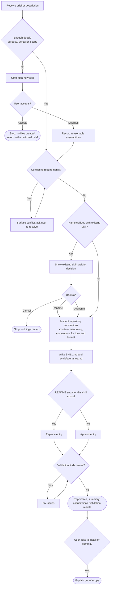

# Review: create-skill

**Reviewed with:** Claude (Claude Code), Opus 5.5, reasoning level unknown

## Summary

`create-skill` turns a confirmed brief from `plan-new-skill`, or a direct description, into a finished skill directory: `SKILL.md`, `evals/scenarios.md`, and a README entry. It is the authoring step of the repository's plan → create → review → update pipeline. Use it whenever someone wants a new skill built rather than designed.

## Scores

| Dimension | Score | Justification |
|---|---|---|
| Scope | 5 | One clear job: author a skill directory. Exclusions for interviewing, git, installation, and running the authored skill are explicit, and both outcomes of the `plan-new-skill` offer are now defined. |
| Human readability | 5 | The numbered workflow headings follow the order of work. The mandated `SKILL.md` structure is a numbered list, and the completion report is a short checklist. |
| Agent executability | 4 | Directives are imperative, precedence between conventions and structure is stated, and completion is defined. An agent still has to guess how to name a skill when no name is given and how to judge "token-efficient" and "reliable" during validation. |
| **Overall** | **4** | Ready to use. The remaining issues are minor edge-case gaps and thin eval coverage, not structural flaws. |

**Rubric**
- **5** Excellent: ready to use; no meaningful issues.
- **4** Good: minor issues that do not affect outcomes.
- **3** Adequate: works, but issues cause occasional inconsistency or waste.
- **2** Weak: significant gaps; results are often unreliable.
- **1** Poor: unclear or unusable without major revision.

## Scope analysis

**Verdict: appropriate.**

- The responsibility is focused. Step 1 says "Do not conduct a requirements interview," and the operating boundary excludes git, installation, and running the authored skill. That leaves file authoring and nothing else.
- The trigger is precise: "Use when the user wants to build a new skill, not plan one." The handoff to `plan-new-skill` is one-way, and accepting the offer now ends the run ("stop without creating files and tell them to return with the confirmed brief").
- Step 6, "Validate the authored skill," is a lightweight self-check that overlaps a little with `review-skill`. That is reasonable as a pre-delivery check, as long as it stays brief.
- The "overwrite" choice in step 2 overlaps with `update-skill`, which is the repository's tool for changing an existing skill. Overwriting rebuilds the skill from scratch and skips that skill's approval and logging. See improvement 3.

## Areas for improvement

### High priority

None.

### Medium priority

1. **Workflow → 1: no rule for naming the skill.** Step 4 requires a kebab-case `name`, but nothing says what to do when the input has none (as in eval scenario 3, "Make me a skill for code reviews").
   *Fix:* "If no name is supplied, derive a short kebab-case verb-noun name from the purpose and list it as an assumption."

2. **Workflow → 1 and Constraints: permitted questions are not labeled as exceptions.** Step 1 bans "iterative clarifying questions," yet the skill requires asking about the `plan-new-skill` offer, name collisions, and conflicting requirements.
   *Fix:* Add one line: "The only permitted questions are the plan-new-skill offer, a name-collision decision, and resolution of conflicting requirements."

3. **Workflow → 2. Check for name collisions: overwrite bypasses `update-skill`.** When a collision is found, "overwrite" replaces an existing skill without the approval list and change log that `update-skill` provides.
   *Fix:* When presenting a collision, mention that `update-skill` is the better route for revising the existing skill, and keep overwrite for full replacements.

4. **Operating boundary / Completion: other skill lists go stale.** The boundary allows edits only to the skill directory and `README.md`, so any other repository file that lists skills, such as an agent instruction file, falls out of date after each new skill.
   *Fix:* Add to Completion: "Remind the user to update any other repository files that list skills."

5. **evals/scenarios.md: several paths are not covered.** There are no scenarios for accepting the `plan-new-skill` offer, choosing "overwrite" (README entry replaced, not duplicated), or choosing "cancel." Scenario 7 ("Validation catches quality issues") gives the agent no planted defect, so its pass condition is hard to observe.
   *Fix:* Add those three scenarios. Rework scenario 7 to use a brief that invites a known issue, such as two sections that restate each other.

### Low priority

6. **Workflow → 6. Validate: "Token-efficient" and "Reliable" have no checkable criteria.** Self-validation against these principles will tend to report "pass."
   *Fix:* Add one concrete check each, for example "no instruction appears in more than one section" and "no 'should' or 'may'; use imperatives." Keep it brief to avoid duplicating `review-skill`.

7. **Completion: no handoff to `review-skill`.** `review-skill` expects to be offered after a skill is created, but `create-skill`'s Completion section does not mention it.
   *Fix:* Add "Offer a review with review-skill once; proceed only if the user agrees."

8. **Workflow → 3. Inspect repository conventions: reads every skill.** "Read existing skills in the repository" makes the read cost grow with each skill added.
   *Fix:* "Read two or three representative skills."

9. **evals/scenarios.md, scenario 5: a host-specific path.** The pass criterion mentions `~/.claude/skills/`, which conflicts with the repository convention that skills avoid host-specific paths.
   *Fix:* Reword as "copy files to any skill installation location."

10. **Frontmatter description: the word "production-quality."** It adds tokens to the always-loaded description without helping trigger selection.
    *Fix:* Remove it, and update the README row to match.

## Token cost

*All figures are estimates at about 4 characters per token.*

| Loading stage | Size | Estimated tokens |
|---|---|---|
| Frontmatter (always loaded) | ~290 chars | ~75 |
| `SKILL.md` body (loaded on invocation) | ~6,350 chars | ~1,600 |
| `evals/scenarios.md` | ~6,400 chars | 0 at runtime (not loaded by the skill) |

**Runtime cost (qualitative):** Moderate. Step 3 reads the other skills in the repository (currently three other `SKILL.md` files, about 1,500 tokens each), and step 2 lists `skills/`. The agent then writes two new files plus a README edit and re-reads them for validation. Read-in context grows linearly with the number of skills in the repository.

## Estimated runtime

*Estimates only.*

- **Typical rounds:** 1 turn with a complete brief. 2–3 turns when the input is thin (plan-new-skill offer), there is a name collision, or the brief has conflicting requirements.
- **Agent processing time:** about 2–5 minutes (reading conventions, writing about 10–15 KB of content, validating).
- **User wait / input time:** about 0–2 minutes, spent only on the offer, collision, or conflict questions.

## Reliability

**Rating: Good (4/5).**

- **Strengths:** Prohibited actions are explicit. Every branch of the `plan-new-skill` offer and the collision decision has a defined outcome. Precedence between repository conventions and the mandated structure is stated. README handling avoids duplicates on overwrite. Conflicting requirements are surfaced rather than resolved silently, and assumptions are kept separate from confirmed requirements.
- **Findings:** Skill naming has no rule, the permitted questions are not labeled as exceptions, and two validation principles are subjective (improvements 1, 2, 6).
- **Evals:** Present. Seven scenarios cover the main path, direct invocation, thin input with decline, collision with rename, out-of-scope requests, conflicting requirements, and validation. The accept-offer, overwrite, and cancel branches are not covered, and scenario 7 is hard to judge.
- **Confidence:** Medium-high. The instructions are now complete on every branch, but the eval suite does not yet exercise the branches that were most recently defined.

## Workflow diagram

