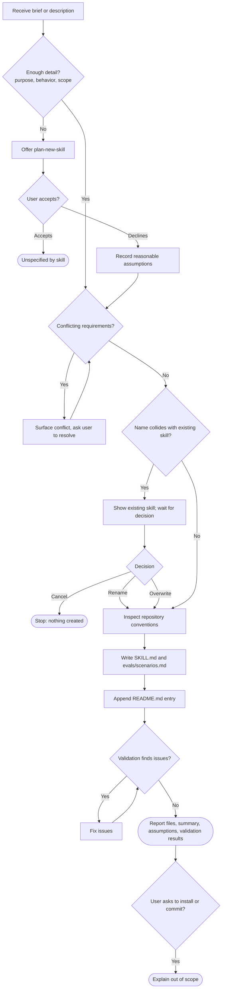

# Review: create-skill

**Reviewed with:** Claude (Claude Code), Opus 5.5, reasoning level medium

## Summary

`create-skill` turns a confirmed brief from `plan-new-skill`, or a direct description, into a finished skill directory: `SKILL.md`, `evals/scenarios.md`, and a README entry. It is the authoring half of the repository's plan → create pipeline. Use it whenever someone wants a new skill built rather than designed.

## Scores

| Dimension | Score | Justification |
|---|---|---|
| Scope | 4 | One clear job (author a skill directory). Exclusions for interviewing, git, and installation are explicit. Some edge cases at its edges are left open: what happens when the user accepts the `plan-new-skill` offer, and how the overwrite path should treat the README. |
| Human readability | 5 | The numbered workflow headings match the order of work. The target `SKILL.md` structure is a numbered list, and the completion report is a short checklist. |
| Agent executability | 4 | Directives are imperative and completion is defined. An agent still has to guess in a few places: how to name the skill when no name is supplied, which wins when repo conventions differ from the mandated structure, and how to judge "token-efficient." |
| **Overall** | **4** | Ready to use. The remaining issues are gaps in edge cases, not structural flaws. |

**Rubric**
- **5** Excellent: ready to use; no meaningful issues.
- **4** Good: minor issues that do not affect outcomes.
- **3** Adequate: works, but issues cause occasional inconsistency or waste.
- **2** Weak: significant gaps; results are often unreliable.
- **1** Poor: unclear or unusable without major revision.

## Scope analysis

**Verdict: appropriate.**

- The responsibility is focused. Step 1 says "Do not conduct a requirements interview," and the operating boundary excludes git, installation, and running the authored skill. That leaves file authoring and nothing else.
- The trigger is precise: "Use when the user wants to build a new skill, not plan one." It separates cleanly from `plan-new-skill`, and the handoff is one-way ("Do not invoke plan-new-skill automatically; only suggest it").
- There is a small overlap with `review-skill`. Step 6, "Validate the authored skill," is a lightweight self-review against quality principles. That is reasonable as a pre-delivery check, but it should stay brief so it does not duplicate the separate review step.

## Areas for improvement

### High priority

1. **Workflow → 1. Receive and assess input: the "user accepts plan-new-skill" outcome is undefined.** The skill says to "offer the user the option to use plan-new-skill" and covers only the decline path. If the user accepts, the agent does not know whether to stop, wait for a brief, or start the interview itself. Starting the interview would break the boundary.
   *Fix:* Add "If the user accepts, stop without creating files and tell them to return with the confirmed brief."

2. **Workflow → 3 vs. 4: conventions and mandated structure can conflict.** Step 3 says "Match these conventions in the new skill." Step 4 prescribes a fixed seven-part structure. The two already disagree: `plan-new-skill` and `review-skill` use an "Output specification" section, while step 4 calls for "Completion and output specification."
   *Fix:* State the precedence. For example: "The step 4 structure is mandatory; use repository conventions for tone, wording, and formatting within it."

3. **Workflow → 5. Update README.md: the overwrite path produces duplicate entries.** Step 2 lets the user choose "overwrite," but step 5 always says "Append an entry." Overwriting an existing skill adds a second README entry.
   *Fix:* "If an entry for this skill already exists, replace it; otherwise append."

### Medium priority

4. **Operating boundary / Workflow → 5: CLAUDE.md goes stale.** The repository's `CLAUDE.md` keeps a "Current Skills" list, but the boundary forbids modifying files outside the skill directory and README.md. Every newly authored skill leaves that list out of date.
   *Fix:* Either add `CLAUDE.md`'s skill list to the permitted files, or tell the agent to remind the user to update it in the completion report.

5. **Workflow → 1–2: no rule for naming the skill.** Step 4 requires a kebab-case `name`, but nothing says what to do when the input has none (as in eval scenario 3, "Make me a skill for code reviews").
   *Fix:* "If no name is supplied, derive a short kebab-case verb-noun name from the purpose and list it as an assumption."

6. **Constraints and edge cases: questions are allowed in places the interview ban seems to forbid.** The skill bans "iterative clarifying questions" but requires asking the user about name collisions and about conflicting requirements. These are sensible single-question exceptions, but they are not labeled as exceptions.
   *Fix:* Add one line: "The only permitted questions are the plan-new-skill offer, a name-collision decision, and resolution of conflicting requirements."

7. **evals/scenarios.md: several paths are not covered.** Missing scenarios: the user accepts the `plan-new-skill` offer, the user chooses "overwrite" or "cancel" on a collision, and repo conventions differ from the mandated structure. Scenario 7 ("Validation catches quality issues") also gives the agent no defect to find, so its pass condition is hard to observe.
   *Fix:* Add those scenarios. Rework scenario 7 to use a brief that invites a known issue, such as two sections that restate each other.

### Low priority

8. **Workflow → 6. Validate: "Token-efficient" and "Reliable" have no checkable criteria.** Self-validation against these principles will tend to report "pass."
   *Fix:* Add one or two concrete checks per principle, for example "no instruction appears in more than one section" and "every 'should' or 'may' is rewritten as an imperative."

9. **Completion: no handoff to review-skill.** `review-skill`'s description expects to be offered after a skill is created, but `create-skill`'s Completion section does not mention it.
   *Fix:* Add "Offer a review with review-skill once; proceed only if the user agrees."

10. **evals/scenarios.md, scenario 5: a host-specific path.** The fail criterion mentions `~/.claude/skills/`, which conflicts with the repository convention that skills avoid host-specific paths.
    *Fix:* Reword as "copy files to any skill installation location."

11. **Frontmatter description: the word "production-quality."** It adds tokens to the always-loaded description without helping trigger selection.
    *Fix:* Remove it.

## Token cost

*All figures are estimates at about 4 characters per token.*

| Loading stage | Size | Estimated tokens |
|---|---|---|
| Frontmatter (always loaded) | ~300 chars | ~75 |
| `SKILL.md` body (loaded on invocation) | ~6,000 chars | ~1,500 |
| `evals/scenarios.md` | ~6,300 chars | 0 at runtime (not loaded by the skill) |

**Runtime cost (qualitative):** Moderate. Step 3 reads existing skills in the repository (currently four other `SKILL.md` files, about 1,000–2,500 tokens each). Step 2 lists `skills/`. The agent then writes two new files plus a README edit and re-reads them for validation. Read-in context grows linearly with the number of skills in the repository. A useful future fix would be to limit step 3 to two or three representative skills.

## Estimated runtime

*Estimates only.*

- **Typical rounds:** 1 turn with a complete brief. 2–3 turns when the input is thin (plan-new-skill offer and decline), there is a name collision, or the brief has conflicting requirements.
- **Agent processing time:** about 2–5 minutes (reading conventions, writing about 10–15 KB of content, validating).
- **User wait / input time:** about 0–2 minutes, spent only on answering the offer, collision, or conflict questions.

## Reliability

**Rating: Good (4/5).**

- **Strengths:** Prohibited actions are explicit. Conflicting requirements are surfaced rather than resolved silently. Assumptions are kept separate from confirmed requirements. A pre-completion validation step catches structural omissions.
- **Findings:** There is one undefined outcome (the user accepts the plan-new-skill offer). One precedence rule is ambiguous (conventions vs. mandated structure). The overwrite path duplicates README entries. Skill naming has no rule. Validation criteria are subjective (see Areas for improvement 1–3, 5, 8).
- **Evals:** Present. There are seven scenarios covering the main path, direct invocation, thin input, collision (rename), out-of-scope requests, conflicting requirements, and validation. The accept-offer, overwrite, and cancel branches are not covered.
- **Confidence:** Medium-high. The eval suite is solid, but the uncovered branches are exactly where the gaps above sit.

## Workflow diagram

