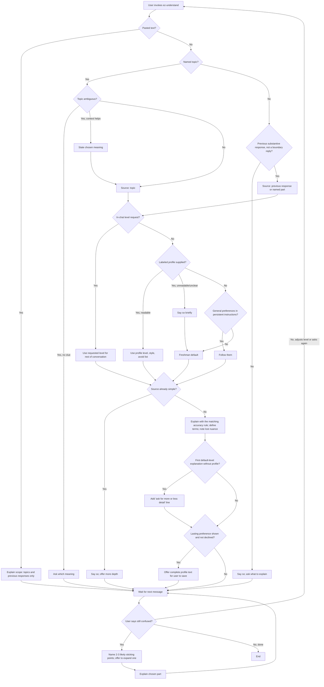

# Review: ez-understand

**Reviewed with:** Claude Code, Opus 5.5, reasoning level unknown

## Summary

ez-understand explains a topic the user names, or re-explains the assistant's previous response, in plain language. The level is set by an in-chat request, a user-kept profile, or a college-freshman default, in that order. It is useful whenever an answer is accurate but hard to follow, and it adapts to experts and learners without depending on host memory or file paths.

## Scores

Rubric: **5** Excellent — ready to use; no meaningful issues. **4** Good — minor issues that do not affect outcomes. **3** Adequate — works, but issues cause occasional inconsistency or waste. **2** Weak — significant gaps; results are often unreliable. **1** Poor — unclear or unusable without major revision.

| Area | Score | Justification |
|------|-------|---------------|
| Scope | 4 | Still one job, plain-language explanation, with explicit exclusions: pasted text, research, file writes. The two source modes in "1. Identify what to explain" are well defined on their own, but the line between them blurs when a named topic was already covered in the previous response. |
| Human readability | 5 | Five short workflow steps with plain headings. The level order and the two accuracy rules in "3. Explain" are easy to scan. |
| Agent executability | 4 | Directives are imperative, and the main branches and edge cases are handled. A few judgment calls remain: which accuracy rule applies when the modes overlap, and how a new "simply" request interacts with a level the user raised earlier. |
| **Overall** | **4** | Ready to use. The improvements below would sharpen a few overlaps rather than fix broken behavior. |

## Scope analysis

**Verdict: appropriate.** Adding named topics widened the skill without diluting it. Both modes share level selection, clarification, and profile handling, and only the accuracy rule differs. No other skill in the repository explains content, so there is no overlap. Pasted text remains a deliberate exclusion.

The broader trigger in the frontmatter `description` ("asks to understand a topic simply") will match many ordinary "explain X simply" questions. That is consistent with the intended purpose, but it means the skill will activate often in general use.

## Areas for improvement

### High priority

None.

### Medium priority

1. **Overlapping source modes — "1. Identify what to explain".**
   - **Issue:** A request like "explain caching simply", made right after a response that covered caching, matches both "Named topic" (well-established knowledge, new claims allowed) and "Previous response" (no new claims). The two accuracy rules in step 3 differ, so the agent has to guess which applies.
   - **Fix:** If the named topic was covered in the previous response, treat the request as re-explaining that part and use the previous-response accuracy rule.
2. **Level after a later "simply" request — "2. Choose the level".**
   - **Issue:** The in-chat rule says a requested level "governs for the rest of the conversation." But a later "explain X simply" could be read as a new request for a lower level, overriding a level the user explicitly raised earlier. Eval scenario 9, turn 6, depends on this case.
   - **Fix:** Say that "simply" or "in plain words" invokes the skill and does not by itself lower a level the user set earlier in the conversation.

### Low priority

1. **General preferences in persistent instructions — "2. Choose the level".**
   - **Issue:** "Follow any general level or style preferences in the host's persistent instructions" could pull in unrelated preferences, such as coding style, as explanation guidance.
   - **Fix:** Limit this to preferences about explanation level or style.
2. **Ambiguous-topic eval — `evals/scenarios.md`.**
   - **Issue:** The "Topic is ambiguous" edge case has no scenario.
   - **Fix:** Add a short scenario with a term like "RAG" in a non-AI context, checking that the skill states the meaning it chose or asks.
3. **Detail line after a level change — "3. Explain".**
   - **Issue:** "On the first default-level explanation in a conversation" doesn't say what happens if the conversation started at a non-default level and later returns to the default.
   - **Fix:** Define it as the first explanation given at the default level, whenever that occurs. This is a minor clarification.

## Token cost

All figures are estimates at about 4 characters per token.

- **Frontmatter (always loaded):** about 410 characters, or roughly **105 tokens**. This is up from about 85 because the description now covers named topics.
- **SKILL.md body (loaded on invocation):** about 6,700 characters, or roughly **1,700 tokens**.
- **Runtime note:** the skill reads no files except an optional profile the user points to. Runtime cost is mostly the source (the previous response, or nothing for a topic) plus the explanation written. Each clarification round adds one more explanation of similar or shorter length.

## Estimated runtime

All figures are estimates.

- **Turns:** one turn per explanation. A typical session runs one to three turns: the explanation, plus an optional clarification and expansion.
- **Agent processing:** about 5–20 seconds per turn. Topic explanations sit at the longer end because they are generated from scratch.
- **User wait time:** mostly reading time, about 1–3 minutes per explanation. Profile suggestions add a short copy-and-save step for the user.

## Reliability

**Rating: good.** The rules for accuracy, level order, source selection, and when not to act are explicit and consistent. Boundary replies are excluded as a source, flagging doubt is not counted as a new claim, and the detail line is limited to one per conversation. The remaining risks are the two medium-priority overlaps: which accuracy rule applies when the modes overlap, and whether "simply" lowers a level the user raised.

**Evals:** present. Nine scenarios cover:
- the default path
- an expert profile
- continued confusion
- lasting versus one-off preferences
- named topics
- pasted text
- an unreadable profile with a conflicting request
- a named part with an already-simple response
- repeated corrections with a declined suggestion

Only the ambiguous-topic edge case is untested.

**Confidence:** moderate to high. The scenarios have not been run yet.

## Workflow diagram

