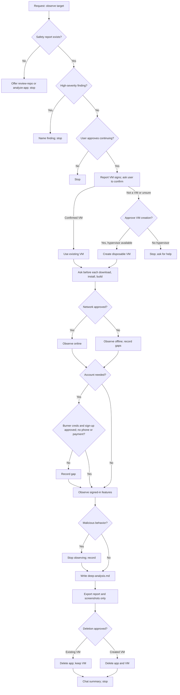

# Review: observe-app

**Reviewed with:** Claude Code, Opus 5.5 (claude-opus-5-5), reasoning level unknown

## Summary

observe-app fills the gap between passive research (`analyze-app`) and a rebuild: it runs a pre-vetted app only inside a disposable VM, with per-step approval, and records rebuild-ready behavior evidence. It would be used when a user wants a planning agent to phase a reverse-engineering effort without risking their own hardware. Its containment and approval rules are strong; the main weaknesses are a safety gate that an `analyze-app` report always passes and several approvals with no stated "declined" outcome.

## Scores

Rubric: **5** Excellent — ready to use; no meaningful issues. **4** Good — minor issues that do not affect outcomes. **3** Adequate — works, but issues cause occasional inconsistency or waste. **2** Weak — significant gaps; results are often unreliable. **1** Poor — unclear or unusable without major revision.

| Dimension | Score | Justification |
|-----------|-------|---------------|
| Scope | 4 | Focused on VM observation with explicit exclusions (phase planning, reverse engineering, vetting); one boundary with `analyze-app` is left implicit. |
| Human readability | 4 | Six numbered workflow steps with clear headings; the 17-section output list is long but each item is one line. |
| Agent executability | 3 | Most steps are imperative, but declined approvals in steps 2 and 6, the network-approval timing, and the gate's meaning for `analyze-app` reports require guessing. |
| **Overall** | **3** | Usable, but the safety gate gap affects the skill's central safety promise. |

## Scope analysis

**Verdict: appropriate.** The skill owns one job (contained runtime observation) and hands vetting to `review-repo` and passive research to `analyze-app`. Exclusions in the Operating boundary ("Do not plan reverse-engineering phases, reverse engineer, rebuild, or perform security vetting") are explicit and backed by Constraints entries.

Overlap note: `analyze-app` still declines every install request and does not point users to observe-app, so users may not discover it from there. This is a note only; changing analyze-app is an update-skill task.

## Areas for improvement

### High

1. **Workflow → 1. Check the safety gate — the gate is vacuous for `analyze-app` reports.** The gate requires a report with "no high-severity findings," but `analyze-app` reports contain no severity findings (that skill explicitly excludes security vetting). Any app with an analyze-app report passes automatically, so the gate only proves the target was identified. **Fix:** state what an analyze-app report satisfies (identification and evidence) and what additional evidence is required for a non-repository app (for example, the user's explicit acknowledgement that no security review exists), or require `review-repo` whenever a repository or downloadable source exists.

### Medium

2. **Workflow → 2. Establish the VM — declined or negative answers are undefined.** "Ask the user to confirm it is disposable or snapshotted" has no outcome for "no," and declining VM creation has no stated outcome. **Fix:** add "If the user says the VM is not disposable, offer to create one; if the user declines VM creation, stop without acquiring the target."
3. **Workflow → 6. Export and clean up — declined deletion is undefined.** "Ask the user to approve deletion" does not say what happens if the user refuses (keep everything and report it, or leave the VM isolated). **Fix:** specify that the skill reports the app and VM as retained, with a reminder that they still contain the untrusted app, and ends.
4. **Workflow → 3. Acquire the target — network approval timing conflicts with downloading.** Downloading needs network access inside the VM, but network approval is described as "before allowing the app network access." An agent cannot tell whether the download approval already covers network use. **Fix:** say that download approval covers fetching the target, and the separate once-per-session approval covers the running app's network access.
5. **Workflow → 4. Handle accounts / Output → Source and session — burner credentials may leak into the report.** The report records "approvals given," and nothing says credentials must be kept out of it. **Fix:** add "Never write passwords or tokens into the report; record only that an account was used."
6. **Workflow → 5. Observe — the malicious-behavior stop applies only during observation.** Suspicious behavior during install or build (step 3) is not covered. **Fix:** move the stop rule into a short standing rule that applies from acquisition through cleanup.

### Low

7. **evals/scenarios.md — gaps in coverage.** No scenario covers a declined install, declined deletion, a non-disposable existing VM, or credentials staying out of the report. Scenario 1 combines download and install into a single approval turn. **Fix:** add scenarios for declined approvals and the credentials rule after the medium items are resolved.
8. **Output specification — section 17 Security observations is not tied to the gate.** Findings there could inform a future `review-repo` run, but the skill does not say whether they should be surfaced in the chat summary. **Fix:** require any security observation to be named in the Completion summary.
9. **Constraints and edge cases — "More than one app" mirrors analyze-app but is the only multi-target rule.** It is fine as is; consider noting that a repository plus its released app counts as one target.

## Token cost

*All figures are estimates at about 4 characters per token.*

- **Frontmatter (always loaded):** ~420 characters → **~105 tokens**.
- **SKILL.md body (loaded on invocation):** ~7,270 characters → **~1,800 tokens**.
- **Runtime cost (qualitative):** high relative to other skills in this repository. A typical run reads one or two prior reports, issues many tool calls inside the VM (installs, process and network inspection, screenshots), and writes a long 17-section report. Observation output, not the skill text, will dominate token use.

## Estimated runtime

*Estimates only; actual time depends heavily on the app and the host's VM support.*

- **Turns:** about 6–10 user turns (gate approval, VM confirmation or creation, download/install, network, possible sign-up, deletion).
- **Agent processing:** roughly 30–120 minutes, more if the skill creates a VM and the app has many features.
- **User wait time:** mostly short replies to approval prompts, plus time to supply burner credentials when needed.

## Reliability

**Rating: 3 (Adequate).** Containment rules are explicit and repeated where they matter (VM-only execution, export limits, no payments or real credentials). Reliability is reduced by the vacuous gate for `analyze-app` reports (item 1), undefined outcomes for declined approvals (items 2–3), and the ambiguous network approval (item 4). The skill's VM capabilities depend on the host and are unverified, but the skill handles absence by stopping.

Evals existed: nine scenarios covering the normal path, missing or failing gate, VM creation, no hypervisor, accounts, malicious behavior, out-of-scope requests, and existing reports with an early stop. Declined approvals are not covered. **Confidence in this rating: medium-high.**

## Workflow diagram

