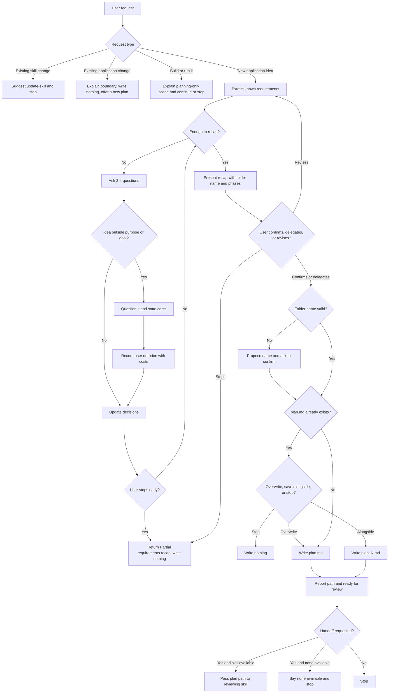

# Review: plan-new-application

**Reviewed with:** Claude Code, Claude Sonnet 5.5, reasoning level unknown

## Summary

`plan-new-application` interviews a user about a new application of any type, challenges out-of-scope ideas, states long-term tradeoffs with verified or unverified labels, and saves a plan (diagram plus phase outline) for a later agent to break into subagent tasks. It would be used at the start of any new app, script, or tool, before anything is built.

## Scores

| Dimension | Score | Justification |
|-----------|-------|---------------|
| Scope | 4 | One clear job (interview, then save one plan) with explicit exclusions in "Operating boundary" and "Constraints and edge cases". It combines interviewing, challenging, research, diagramming and phasing, but all serve one deliverable. |
| Human readability | 5 | Headings follow the run in order (Interview, Tradeoffs, Confirmation, Saving the plan, Output specification, Completion). The seven-section plan layout is easy to scan. |
| Agent executability | 4 | Directives are imperative, and save, collision, and fallback behavior are specified. A few judgment calls stay subjective (see improvements 1–3). |
| **Overall** | **4** | Good. The remaining gaps are minor and unlikely to change outcomes, but they could cause some run-to-run variation. |

Rubric: 5 excellent, 4 good, 3 adequate, 2 weak, 1 poor.

## Scope analysis

**Verdict: appropriate.** The skill has a single outcome (a saved `plan.md`) and a clear boundary against building, per-subagent tasking, and launching the reviewing agent. Changes to existing applications and existing skills are redirected rather than handled.

- **Breadth:** the body is about 2,300 tokens, which is moderate. The branches (early stop, collision, waived confirmation, no file access, handoff) are each short and do not compete with the main path.
- **Overlap:** `analyze-app` has an optional "Handoff for planning" section about existing apps, while this skill plans new ones, so there is no real conflict. The "Changes to an existing skill" bullet duplicates routing that `plan-new-skill` and `update-skill` already do; it is harmless and could be dropped to save tokens.

## Areas for improvement

### High priority

None.

### Medium priority

1. **Scope challenge remains judgment-based** (Interview › Challenge scope). The new test ("does it serve the confirmed purpose, goal, or core features?") helps, but there is no guidance for borderline items such as a social-sharing feature in a fitness tracker, so challenges may still vary. Fix: add one sentence on borderline cases, for example "when unsure, ask one short question about how it serves the goal instead of listing costs".
2. **Description says "verified" tradeoffs, body allows unverified ones** (frontmatter vs. Tradeoffs). The description promises "state verified long-term tradeoffs", but the body permits "general knowledge, unverified" labels. A reader may expect every claim to be verified. Fix: reword the description to "state long-term tradeoffs labeled verified or unverified".

### Low priority

3. **Recap may be long** (Confirmation). A "short recap" must cover requirements, scope, stack, tradeoffs, phases, assumptions and the folder name. Fix: say the recap lists key items only and the full detail goes in `plan.md`.
4. **Redundant edge-case bullet** (Constraints › Changes to an existing skill). It duplicates other skills' routing. Fix: remove it, or fold it into the existing-application bullet, to save tokens.
5. **No fallback when `private/` cannot be created** (Saving the plan). The only fallback is for hosts that cannot write files at all. Fix: add that a failed write is reported with the plan presented in chat.
6. **Eval 10's setup is non-deterministic** (`evals/scenarios.md`, scenario 10: "may or may not be available"). Fix: state that no reviewing skill is required for the scenario.
7. **Eval gaps:** no scenario for a borderline feature that should not be over-challenged, for the overwrite and stop options in the collision question, for the verification limit, or for a host that can verify sources. Fix: add one scenario each for borderline challenge and for overwrite or stop.

## Token cost

All figures are estimates at about 4 characters per token.

| Stage | Characters | Estimated tokens |
|-------|-----------|------------------|
| Frontmatter (always loaded) | ~460 | ~115 |
| `SKILL.md` body (loaded on invocation) | ~9,260 | ~2,320 |

The skill reads no files and writes one, so runtime cost is dominated by the conversation. Searches for verification add tokens when the host supports them; the verification limit in "Tradeoffs" keeps this bounded. `evals/scenarios.md` (~3,400 tokens) is for maintainers and is not loaded at runtime.

## Estimated runtime

Estimates only.

- **Turns:** about 3–5 interview rounds, one recap exchange, and possibly one collision or folder-name question. Roughly 5–8 user turns.
- **Agent processing:** about 10–40 seconds per turn, plus 1–3 minutes in total for verification when available, and 30–60 seconds to write the plan.
- **User wait and thinking time:** the largest share, around 10–30 minutes for a typical application.
- **Total:** roughly 15–40 minutes, mostly the user's time.

## Reliability

**Rating: good, with moderate confidence.** There are 18 eval scenarios covering the main path, scope challenge, deferred-auth tradeoff, build-request boundary, folder collision, early stop, sufficient request, no verification access, skill-change redirect, handoff (requested and not), delegated decision, conflict, recap revision, waived confirmation, no file access, unsafe folder name, and existing application. No evals have been run, so confidence rests on reading the skill.

Findings:

- No contradictions were found within the skill. The description's "verified" wording slightly overstates the body (improvement 2).
- Residual variation risk is in the subjective scope-challenge test and in how many sources count as enough verification.
- Eval gaps are listed in improvement 7.

## Workflow diagram

