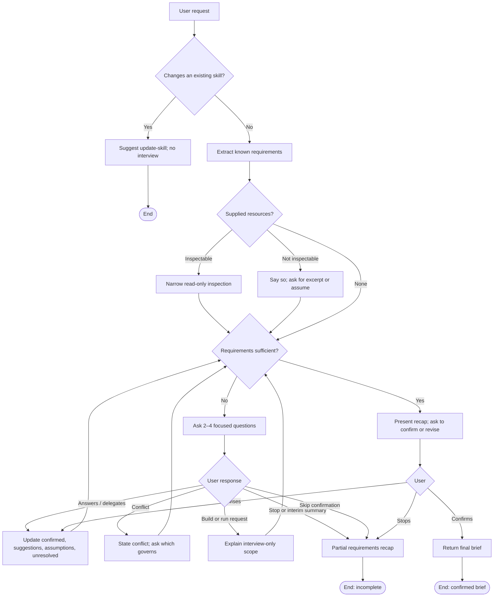

# Review: plan-new-skill

**Reviewed with:** Claude (Claude Code), Opus 5.5, reasoning level unknown

## Summary

`plan-new-skill` turns a rough skill idea into a confirmed requirements brief through a short, adaptive interview. It is the first step of the repository's plan → create → review → update pipeline, and its brief is the input `create-skill` expects. Use it when someone has an idea for a new skill but hasn't settled its purpose, scope, outputs, or boundaries.

## Scores

| Area | Score | Justification |
|------|-------|---------------|
| Scope | 5 | One clear job (interview → brief). Exclusions are explicit: no drafting, no files, no execution, and changes to existing skills go to `update-skill`. |
| Human readability | 4 | The new layout (Interview → Confirmation → Constraints and edge cases → Output specification → Completion) is easy to scan. The description and purpose statement are a little wordy. |
| Agent executability | 4 | Directives are imperative and edge cases are listed together. Two small gaps: the number of rounds is unstated, and what happens after a "skip confirmation" request is unclear. |
| **Overall** | **4** | Ready to use. The remaining issues are minor wording and edge-case gaps, not structural flaws. |

**Rubric**

- **5** Excellent — ready to use; no meaningful issues.
- **4** Good — minor issues that do not affect outcomes.
- **3** Adequate — works, but issues cause occasional inconsistency or waste.
- **2** Weak — significant gaps; results are often unreliable.
- **1** Poor — unclear or unusable without major revision.

## Scope analysis

**Verdict: appropriate.** The skill does one thing: gather and confirm requirements. The triggers ("a new AI skill idea, or a revision of one not yet authored") are precise, and the operating boundary and "Changes to an existing skill" edge case separate it from `create-skill` and `update-skill`. It doesn't overlap any other skill in the repository.

## Areas for improvement

### High priority

None.

### Medium priority

1. **Constraints and edge cases: "Request to skip confirmation" doesn't say whether the interview stops.** "Early stop or interim summary" says "do not continue questioning unless the user resumes," but the skip-confirmation rule only says to "provide a partial requirements recap and explain…". An agent can't tell whether to keep interviewing afterward, and eval scenario 10 only rules out continuing "without explanation."
   *Fix:* Add "then ask whether to continue toward a confirmed recap or stop here" to the skip-confirmation rule, and test both answers in scenario 10.

### Low priority

2. **Ask adaptive questions: the number of rounds is unstated.** The size of each round is set (2–4 questions), but not how many rounds to run. Some agents will rush to a recap; others will keep asking.
   *Fix:* "Continue rounds until the readiness test in Confirmation is met; there is no fixed round limit."
3. **Frontmatter description: the last sentence repeats the operating boundary.** "This skill does not author skill instructions, create files, or execute the proposed workflow" is loaded in every session and duplicates the body. The description is about 400 characters.
   *Fix:* Shorten it to "Interview only; creates no files." This saves about 25 tokens per session.
4. **Purpose statement: the repository-review example appears twice.** "a repository-review request is one example, not the default task" repeats the point the "Adapt to the domain" paragraph makes in more detail.
   *Fix:* Drop the sentence from the purpose statement.
5. **Ask adaptive questions: soft wording.** "Each question should resolve one meaningful gap" uses "should" where the rest of the skill uses imperatives.
   *Fix:* "Make each question resolve one meaningful gap."
6. **Completion: no pointer to `create-skill`.** The brief is written for "a separate authoring agent," but the user isn't told which skill takes it next.
   *Fix:* Add one line saying that `create-skill` can author the skill from this brief, without invoking it.

## Token cost

*All figures are estimates at about 4 characters per token.*

- **Frontmatter (always loaded):** about 100 tokens.
- **SKILL.md body (loaded on invocation):** about 2,000 tokens.
- **Runtime cost:** dominated by conversation length, not file reads. A typical interview runs 3–6 turns, and each turn re-sends the growing conversation. The skill reads files only when the user supplies them.

## Estimated runtime

*Estimates.*

- **Turns:** 3–6 turns for a typical idea (1–3 question rounds, a recap, confirmation, then the brief). A detailed request can take 2 turns.
- **Agent processing time:** about 10–30 seconds per turn.
- **User wait time (answering questions):** about 5–20 minutes in total, depending on how settled the idea is.

## Reliability

**Rating: 4 (Good).**

- **Strengths:** It tracks four decision states (confirmed, suggestions, assumptions, unresolved). Confirmation is a separate turn from the brief, and conflicts must be surfaced rather than resolved silently.
- **Gaps:** what happens after a skip-confirmation request (medium #1), and the unstated round limit (low #2).
- **Evals:** present. The 11 scenarios cover the main path, a detailed request, conflicts, unavailable inspection, recap revisions, build/run requests, early stop, a sufficient request, delegated decisions, skipped confirmation, and the `update-skill` redirect.
- **Confidence:** high. Every edge case in the skill has a matching scenario.

## Workflow diagram

