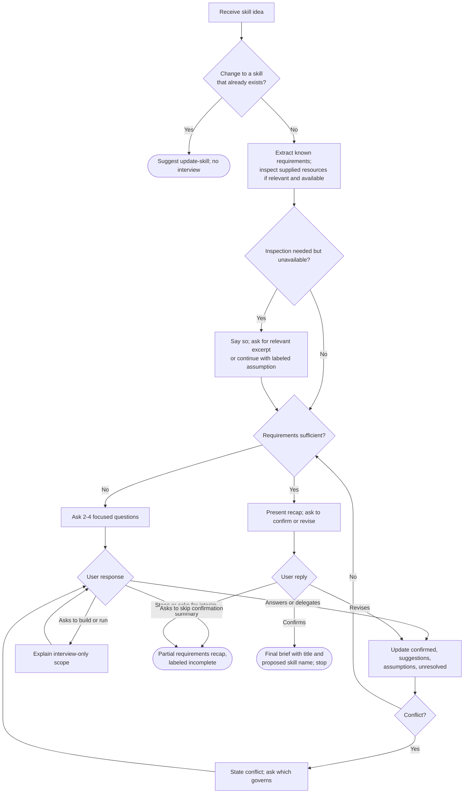

# Review: plan-new-skill

**Reviewed with:** Claude (Claude Code), Opus 5.5, reasoning level unknown

## Summary

`plan-new-skill` turns a rough skill idea into a confirmed requirements brief through a short, adaptive interview. It is the first step of the repository's plan → create → review → update pipeline, and its brief, which now includes a proposed skill name, is the input `create-skill` expects. Use it when someone has an idea for a skill that has not been built yet and has not settled its purpose, scope, outputs, or boundaries.

## Scores

| Dimension | Score | Justification |
|---|---|---|
| Scope | 5 | One clear job, interviewing, with strong exclusions ("Do not draft the proposed `SKILL.md`… create or edit files, install a skill, or perform the proposed skill's work"). The trigger is limited to ideas "not yet authored," and changes to existing skills go to `update-skill`. |
| Human readability | 4 | The headings follow the flow of an interview, and the four tracking states and six gap dimensions are easy to scan. Several paragraphs are dense, and "Confirmation and completion" packs readiness, recap, revision, and final output into one section. |
| Agent executability | 4 | Round size (2–4 questions), the readiness test, the confirmation gate, the early-stop path, and the redirect to `update-skill` are clearly specified. The number of rounds is left open without saying so, so an agent may cut an interview short or let it drift. |
| **Overall** | **4** | Ready to use. The remaining issues are small wording and coverage gaps, not structural flaws. |

**Rubric**
- **5** Excellent: ready to use; no meaningful issues.
- **4** Good: minor issues that do not affect outcomes.
- **3** Adequate: works, but issues cause occasional inconsistency or waste.
- **2** Weak: significant gaps; results are often unreliable.
- **1** Poor: unclear or unusable without major revision.

## Scope analysis

**Verdict: appropriate.**

- The responsibility is focused on requirements gathering. The operating boundary forbids drafting, file changes, installation, and doing the proposed skill's work, and it says how to respond when the user asks for any of them mid-interview.
- The trigger is precise: "a new AI skill idea, or a revision of one not yet authored," used "before implementation."
- It does not overlap other skills. "If the user wants to change a skill that already exists, suggest `update-skill` instead" separates it from `update-skill`. The handoff to `create-skill` stays manual ("Do not automatically invoke another skill").

## Areas for improvement

### High priority

None.

### Medium priority

1. **evals/scenarios.md: the `update-skill` redirect is untested.** The operating boundary now says to suggest `update-skill` and "do not interview for that change," but no scenario asks to change an existing skill.
   *Fix:* Add a scenario such as "Help me rework the questions in plan-new-skill." Pass: the agent suggests `update-skill` and does not start an interview. Fail: it interviews for the change or edits files.

### Low priority

2. **Ask adaptive questions: the number of rounds is unstated.** The skill sets the size of each round (2–4 questions) but not how many rounds to run. If several rounds are intended, an agent can't tell; some agents will rush to a recap and others will keep asking.
   *Fix:* State the intent explicitly, for example: "Continue rounds until the readiness test in Confirmation and completion is met; there is no fixed round limit."

3. **Frontmatter description: the boundary sentence repeats the body.** "This skill does not author skill instructions, create files, or execute the proposed workflow" restates the operating boundary in the always-loaded description, which has grown to about 410 characters.
   *Fix:* Shorten it to "Interview only; creates no files." This saves about 25 tokens per session.

4. **Purpose statement and Ask adaptive questions: the repository-review example appears twice.** The purpose statement ("a repository-review request is one example, not the default task") and the "Adapt to the domain" paragraph both spend words on the same example.
   *Fix:* Keep the "Adapt to the domain" example and drop the sentence from the purpose statement.

5. **Ask adaptive questions: soft wording.** "Each question should resolve one meaningful gap" uses "should" where the rest of the skill uses imperatives.
   *Fix:* "Make each question resolve one meaningful gap."

6. **Confirmation and completion: no pointer to `create-skill`.** The brief is written for "a separate authoring agent," but the user is not told which skill takes it next.
   *Fix:* After the final brief, add one line saying that `create-skill` can author the skill from this brief, without invoking it.

## Token cost

*All figures are estimates at about 4 characters per token.*

| Loading stage | Size | Estimated tokens |
|---|---|---|
| Frontmatter (always loaded) | ~410 chars | ~105 |
| `SKILL.md` body (loaded on invocation) | ~7,800 chars | ~1,950 |
| `evals/scenarios.md` | ~12,300 chars | 0 at runtime (not loaded by the skill) |

**Runtime cost (qualitative):** Low per turn but spread over several turns. The skill reads no files unless the user supplies some, and then only narrowly. Context grows with each interview round, and the final turn produces a brief of roughly 400–1,000 words.

## Estimated runtime

*Estimates only.*

- **Typical rounds:** 3–6 turns: 1–3 question rounds, a recap, an optional revision, and the final brief. A fully specified request can finish in 2 turns (recap, then brief). A redirect to `update-skill` ends in 1 turn.
- **Agent processing time:** about 10–30 seconds per turn, or about 1–3 minutes in total.
- **User wait / input time:** about 5–15 minutes answering questions and reviewing the recap. This is most of the elapsed time.

## Reliability

**Rating: Good (4/5).**

- **Strengths:** The confirmation gate is strict ("silence or earlier approval of the general idea does not confirm it"). The four tracking states keep suggestions and assumptions separate from confirmed requirements. Conflicts must be raised, not resolved silently. The early-stop, skip-confirmation, and existing-skill paths all have defined outcomes. The brief's proposed skill name is labeled as a suggestion unless confirmed.
- **Findings:** The redirect to `update-skill` has no eval, and the open-ended number of rounds is implied rather than stated (improvements 1–2).
- **Evals:** Present. Ten scenarios cover a broad idea, a detailed request, conflicting requirements, unavailable inspection, recap revision, mid-interview build or run requests, early termination, a request that goes straight to recap, a delegated decision, and a skip-confirmation request. Only the `update-skill` redirect is uncovered.
- **Confidence:** High. The eval suite closely matches the skill's paths and boundaries.

## Workflow diagram

