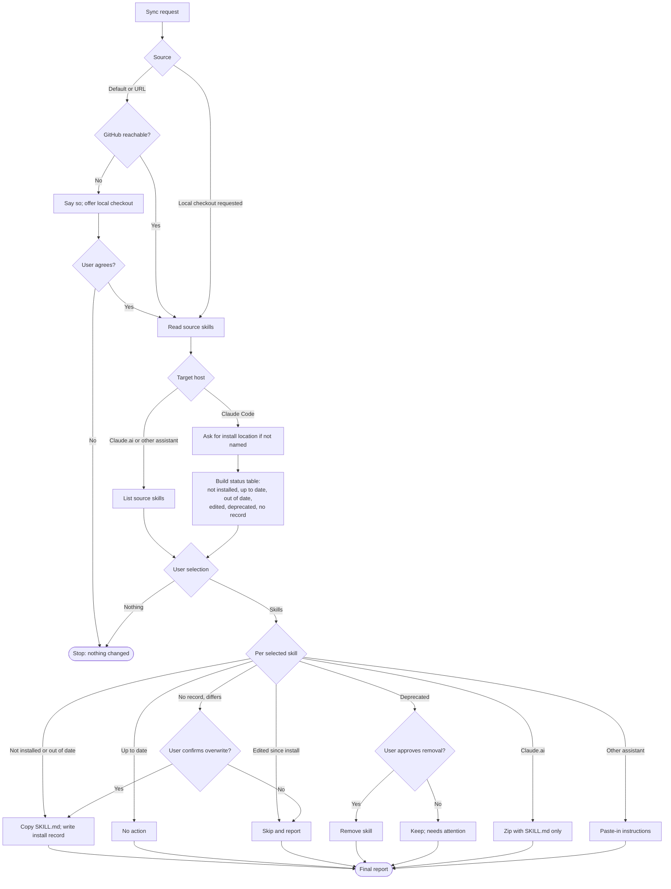

**NOTE: SKILL.MD AND EVALS/SCENARIOS.MD HAVE BEEN UPDATED SINCE THIS REVIEW WAS WRITTEN. THIS REVIEW HAS NOT BEEN UPDATED SINCE THEN.**

# Review: sync-skills

**Reviewed with:** Claude (Claude Code), Opus 5.5, reasoning level unknown

## Summary

`sync-skills` closes the gap left by every other skill in the repository, all of which forbid installation. It downloads skills from a source repository, shows each installed skill's status, and installs, updates, or removes only what the user selects. Use it whenever skills need to be installed for the first time, brought up to date, or packaged for Claude.ai or ChatGPT.

## Scores

| Dimension | Score | Justification |
|---|---|---|
| Scope | 4 | One clear job, with strong exclusions ("Do not perform git operations of any kind… Do not edit skill content… Do not sync on a schedule"). However, "Deprecated — installed, but no longer present in the source" reaches skills the sync never installed. |
| Human readability | 4 | The seven workflow steps follow the order of work, and the status names are plain. The rules for one status are split: "Differs, no install record" is listed in step 3 but defined only in Constraints and edge cases. |
| Agent executability | 3 | Selection, skip, and removal rules are imperative and gated on approval. An agent still has to guess which status wins when more than one applies, which branch to read from GitHub, and whether a skill from another source counts as deprecated. |
| **Overall** | **4** | Ready to use with care. The approval gates prevent damage, but the status list can mislabel skills until the ownership and precedence gaps are fixed. |

**Rubric**
- **5** Excellent: ready to use; no meaningful issues.
- **4** Good: minor issues that do not affect outcomes.
- **3** Adequate: works, but issues cause occasional inconsistency or waste.
- **2** Weak: significant gaps; results are often unreliable.
- **1** Poor: unclear or unusable without major revision.

## Scope analysis

**Verdict: appropriate.**

- The responsibility is focused: read a source, compare, and act on a selection. It covers three host types without growing into skill authoring or editing, and it points to `create-skill`, `review-skill`, and `update-skill` for those.
- The trigger is precise: "install, download, sync, update, or check the status of skills." The word "update" could collide with `update-skill`, but the Constraints section routes content changes there ("If the user asks to change a skill, suggest `update-skill`").
- There is no overlap with other skills. It is the only skill permitted to write outside the repository.

## Areas for improvement

### High priority

1. **Workflow → 3. Build the status list: skills from other sources are marked deprecated.** "Deprecated — installed, but no longer present in the source" applies to every installed skill that the source lacks. A user-level skills folder often holds skills from elsewhere, such as other repositories, plugins, or host-provided skills. Each of those would be listed as deprecated and offered for removal.
   *Fix:* "Deprecated — has an install record from this source, but is no longer present in the source." List installed skills that have no record and are absent from the source as **Not from this source**. Never offer to remove them.

### Medium priority

2. **Workflow → 3: no precedence when statuses overlap.** The status rules compare the installed copy against both the source and the install record, but they don't say which comparison comes first. For example, a copy edited by hand to match the new source both "matches the source" (up to date) and "differs from its install record" (edited).
   *Fix:* Define an order. Check "matches the source" first (up to date, and refresh the record). Then check for a missing record, then "differs from record" (edited), then "matches record" (out of date).

3. **Workflow → 1. Determine the source: branch or revision is unstated.** "Use the GitHub repository `SeanEArc/Agentic_Skills`" doesn't say which branch to read, and step 5 records "the source revision when available."
   *Fix:* "Read the repository's default branch unless the user names a branch, tag, or commit, and record the commit identifier as the source revision."

4. **evals/scenarios.md: several specified paths are untested.** No scenario covers the user selecting nothing ("change nothing and stop"), a restricted repository ("Do not ask for credentials or tokens in chat"), a request to change a skill (the redirect to `update-skill`), or skills from another source in the install folder (finding 1).
   *Fix:* Add one scenario for each. In the restricted-repository scenario, check that the agent offers the local checkout and never asks for a token.

### Low priority

5. **Workflow → 1: the default repository ties the skill to one owner.** Hard-coding `SeanEArc/Agentic_Skills` matches the brief, but anyone else who installs the skill gets the wrong default.
   *Fix:* Keep the default, and state in the operating boundary that it is the owner's repository and can be changed by editing that one line.

6. **Workflow → 5. Install or update: install record format is open.** "Such as a content fingerprint or a copy" leaves the record format to each run, so records written in different runs may not be comparable.
   *Fix:* Pick one format, such as a SHA-256 fingerprint of the installed `SKILL.md` plus source, revision, and date in a small file with a fixed name.

7. **Frontmatter description: the status list is spelled out.** Listing all five statuses in the always-loaded description adds about 20 tokens without improving trigger selection.
   *Fix:* "…show the status of every installed skill, and install, update, or remove only the skills the user selects."

## Token cost

*All figures are estimates at about 4 characters per token.*

| Loading stage | Size | Estimated tokens |
|---|---|---|
| Frontmatter (always loaded) | ~350 chars | ~90 |
| `SKILL.md` body (loaded on invocation) | ~6,150 chars | ~1,550 |
| `evals/scenarios.md` | ~6,200 chars | 0 at runtime (not loaded by the skill) |

**Runtime cost (qualitative):** Moderate, and it grows with the number of skills. Each run reads every source `SKILL.md` (about 1,500–2,500 tokens each, six skills today), every installed `SKILL.md`, and its install record. Retrieving from GitHub adds network calls. A future fix would be to compare install records with fingerprints before reading full files.

## Estimated runtime

*Estimates only.*

- **Typical rounds:** 2–3 turns: the install location (if not given), the selection, and removal approvals for deprecated skills. Claude.ai and ChatGPT requests for a named skill can finish in 1 turn.
- **Agent processing time:** about 1–3 minutes (fetching, comparing, copying, reporting).
- **User wait / input time:** about 1–3 minutes, spent choosing skills and approving removals.

## Reliability

**Rating: Adequate (3/5).**

- **Strengths:** Every write is limited to selected skills in a named location. Edited copies are never overwritten. Removal needs explicit, per-skill approval. Silent source fallback is forbidden. The no-write and no-zip fallbacks are explicit, and credentials are never requested in chat.
- **Findings:** Skills that don't belong to the source are marked deprecated. Status precedence is undefined, the branch is unstated, and the record format is open (improvements 1–3, 6). The approval gates keep these from causing data loss, but they can produce a misleading status list.
- **Evals:** Present. Ten scenarios cover the main sync, an edited copy, deprecated removal, Claude.ai packaging, ChatGPT paste-in, a local checkout, GitHub unreachable, a missing install record, a git request, and no write access. Empty selection, restricted access, the `update-skill` redirect, and foreign skills are not covered.
- **Confidence:** Medium. The suite is broad, but its scenarios assume every installed skill came from the source, which hides finding 1.

## Workflow diagram

